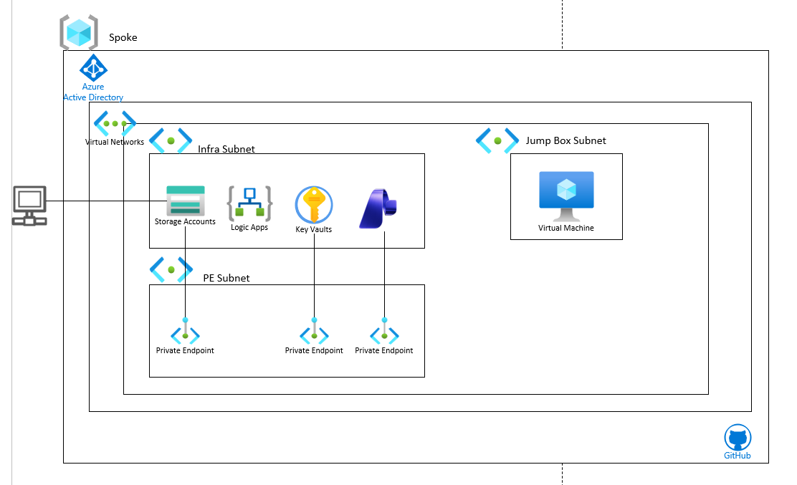

# Content Understanding Logic App Deployment

Reusable Azure public-cloud deployment for a private Azure Logic Apps Standard
document-processing solution with optional **Azure Content Understanding in Foundry Tools**.
The deployment provisions infrastructure and publishes the sample workflow package.

[](https://portal.azure.com/#create/Microsoft.Template/uri/https%3A%2F%2Fraw.githubusercontent.com%2Fabtyagi09%2Fcontent-understanding-logicapp%2Fmain%2Fazuredeploy.json)

The button deploys the Azure infrastructure and managed-identity assignments.
Afterward, use the repository's **Deploy Content Understanding Logic App** GitHub
Actions workflow to publish the workflow package and run its host health check.
For a single local command that performs both phases, use `scripts\deploy.ps1`.

## Architecture diagram



## Architecture

| Diagram component | Implementation |
| --- | --- |
| Spoke | One VNet, default `10.50.0.0/16` |
| Infra subnet | `snet-infra`, `10.50.1.0/26`, delegated to `Microsoft.Web/serverFarms` for Logic Apps Standard integration |
| Jump Box subnet | `snet-jumpbox`, `10.50.2.0/24`, optional private Ubuntu 22.04 VM, SSH public-key authentication |
| PE subnet | `snet-private-endpoints`, `10.50.3.0/24`, no delegation |
| Storage | Private StorageV2 account, private `documents` and `results` containers, Azure Files runtime content share |
| Logic Apps | Windows Standard app, WS1 by default, system-assigned managed identity; optional inbound private endpoint |
| Key Vault | Private, RBAC-enabled vault with soft delete and purge protection |
| AI Foundry | Optional private `AIServices` account and Content Understanding project; API-key authentication disabled |
| Private endpoints | Four for Storage (Blob, File, Queue, Table), one for Key Vault, optional Logic App ingress, and one for Foundry when enabled |
| Private DNS | Storage and Key Vault zones always; App Service zone when Logic App public access is disabled; Cognitive Services, OpenAI, and Foundry Services zones only when Foundry is enabled |
| Entra ID | Logic App managed identity with Storage Blob Data Owner, Queue/Table Data Contributor, Key Vault Secrets User, and, when Foundry is enabled, Cognitive Services User at resource scope |
| Deployment | PowerShell/Azure CLI and GitHub Actions with Microsoft Entra OIDC |

Storage, Key Vault, and Foundry are PaaS resources: they are not deployed into the
infra subnet. Their private endpoint network interfaces reside in the PE subnet.
The infra subnet is dedicated to Logic Apps VNet integration.

## Files

`bicep\main.bicep` orchestrates the modules in `bicep\modules`.
`bicep\main.bicepparam` contains safe local defaults.
`azuredeploy.json` and `azuredeploy.parameters.json` are generated artifacts.
`scripts\deploy.ps1` deploys infrastructure and packages/publishes the workflow.
`scripts\package-customer.ps1` creates a clean customer ZIP excluding the POC SSH
keys, Terraform directory, and prebuilt package.

The `terraform` directory is legacy infrastructure and is **not equivalent** to
this architecture. Do not apply it. The `.ssh` directory and existing package are
local POC files; they are not required for deployment and must not be included in a
customer handoff. Only SSH public keys may be used.

## Deploy from PowerShell and Azure CLI

Use a **new resource group**. This replacement changes names and subnet layout;
it is not an in-place migration of the previous environment. Incremental ARM
deployment does not delete old resources. Removing local templates does not
remove Azure resources.

Prerequisites: Azure CLI 2.48.1 or later, an authenticated Azure account, and a
subscription/region with Logic Apps Standard availability. Enable Foundry only in a
subscription/region that supports Content Understanding and has the required capacity.
The deploying identity needs permission to create the resource group and register
providers, plus Contributor and role-assignment write permission on the target
resource group (for example, Contributor plus Role Based Access Control Administrator).
Required providers are Microsoft.Authorization, Microsoft.Network, Microsoft.Storage,
Microsoft.Web, and Microsoft.KeyVault. Microsoft.CognitiveServices is registered only
when Foundry is enabled; Microsoft.Compute is registered only when the optional jump
box is enabled. If subscription-level
registration permissions aren't available, ask an administrator to register
unregistered providers and pre-create the resource group.

```powershell
az login
.\scripts\deploy.ps1 `
  -SubscriptionId <subscription-id> `
  -ResourceGroupName rg-content-understanding `
  -Location westus3 `
  -NamePrefix cuapp `
  -DeployFoundry
```

The script creates the resource group if needed, registers required resource
providers, shows a deployment preview, deploys Bicep, packages the workflow files
without local settings, and deploys the package using Microsoft Entra-authenticated
Azure CLI. It prompts before deployment; pass `-Approve` for noninteractive use.
`-WhatIfOnly` previews the deployment without creating Azure resources beyond the
resource group/provider registration. Names use a lowercase alphanumeric prefix of
3-7 characters. Use a new resource group and choose non-overlapping VNet CIDRs;
pass `-VnetAddressPrefix`, `-InfraSubnetPrefix`, `-JumpboxSubnetPrefix`, and
`-PrivateEndpointSubnetPrefix` when the defaults conflict with customer networks.
Foundry creation is off by default. Add `-DeployFoundry` to create the private Foundry
account, Content Understanding project/private endpoint, and Logic App role assignment.
Without that switch, no Foundry resources or Cognitive Services role assignments are
created, and the sample workflow has no Content Understanding endpoint configured.
The script also accepts `-LogicAppSku`, `-ContentUnderstandingAnalyzer`, and
`-DisableLogicAppPublicNetworkAccess`. Disabling public ingress automatically creates
a Logic App private endpoint in the PE subnet, links `privatelink.azurewebsites.net`
to the VNet, and includes the SCM DNS record. Run deployment and health checks from a
machine or runner connected to that VNet; a public GitHub-hosted runner cannot reach
the private app.

The private jump box is optional and off by default. To enable it, provide a public
key file (never a private key):

```powershell
.\scripts\deploy.ps1 `
  -SubscriptionId <subscription-id> `
  -ResourceGroupName rg-content-understanding `
  -Location westus3 `
  -DeployJumpbox `
  -SshPublicKeyPath "$HOME\.ssh\id_ed25519.pub"
```

If the customer's Storage policy denies account-key access, the Logic Apps Standard
Azure Files content share requires an explicitly approved exception. Only after that
approval, add `-ApproveAzureFilesSharedKeyException`; this applies
`SecurityControl=Ignore` to the Storage account only. The exception is not enabled
by default and is not appropriate for subscriptions that don't use this policy.

## GitHub deployment

Configure a Microsoft Entra application or user-assigned identity with a federated
credential matching the repository and permitted branch. Grant it permissions to
create the resource group and register providers, plus resource deployment and
role-assignment permissions described above. Prefer pre-created resource groups and
pre-registered providers when subscription-wide privileges are not appropriate.

Set repository variables `AZURE_CLIENT_ID`, `AZURE_TENANT_ID`, and
`AZURE_SUBSCRIPTION_ID`. Run `.github\workflows\deploy-bicep.yml` manually and supply
the resource group, region, and prefix. Set the `JUMPBOX_SSH_PUBLIC_KEY` repository
secret only if enabling the optional jump box. The workflow accepts the analyzer,
plan SKU, `deployFoundry` (false by default), and VNet/subnet CIDRs as deployment inputs.
Set `deployFoundry` to true to create the Foundry account, project, private endpoint,
DNS zones, and Logic App access assignment. When false, none of those Foundry resources
are created and the sample workflow has no Content Understanding endpoint configured.
It previews and deploys
infrastructure, then deploys the Logic App package using Azure CLI and OIDC when public
ingress is enabled. Set `logicAppPublicNetworkAccess` to false to add the private
endpoint; in that mode, the hosted runner skips package deployment and host probing.
Publish and verify from a VNet-connected runner or machine. The workflow does not use a
publish profile or client secret.

## Network and authentication boundaries

- Storage and Key Vault deny public data-plane access. When enabled, Foundry also denies
  public data-plane access. Access requires private network connectivity, private DNS
  resolution, and appropriate authorization.
- The Logic App and SCM HTTPS endpoints are public by default so hosted deployment
  agents can publish the workflow package. When `logicAppPublicNetworkAccess` is false,
  the template disables public access and creates an inbound private endpoint with a
  VNet-linked `privatelink.azurewebsites.net` zone; its DNS zone group includes the
  app and SCM records. Private callers and deployment clients need connectivity to the
  VNet and working private DNS. Request triggers still need their own authorization
  design; signed callback URLs are secrets. Basic
  SCM/FTP publishing authentication is disabled; deployment uses Azure CLI with
  Microsoft Entra authentication.
- The Logic App system-assigned managed identity accesses Blob, Queue, and Table
  Storage for the Functions host. `logicapp\connections.json` also authenticates
  workflow Blob operations with `ManagedServiceIdentity`. Storage Blob Data Owner,
  Storage Queue Data Contributor, and Storage Table Data Contributor are granted
  at the storage-account scope for these uses. The host settings include both
  `AzureWebJobsStorage__credential=managedidentity` and
  `AzureWebJobsStorage__credentialType=managedIdentity`: the Functions host and
  Logic Apps Edge storage provider consume different setting names. Because this
  template uses a system-assigned identity, it does not set
  `AzureWebJobsStorage__managedIdentityResourceId`; set that only when configuring
  a user-assigned identity, and use that identity's full Azure resource ID.
- The WS1 Workflow Service Plan still requires an Azure Files content-share
  connection string. This is the **only** shared-key authentication exception:
  `AzureWebJobsStorage` uses managed identity, not an account key. The Storage
  account requests shared-key access for the content share. The optional
  `SecurityControl=Ignore` tag is applied only when the customer explicitly approves
  the exception. If policy blocks shared-key access and the exception is not
  approved, the Logic App host cannot mount its content share and will not start.
  The content share is pre-created through ARM; provisioning-time content-share
  validation is skipped because Storage denies public access.
  The file-share connection key is resolved during deployment and isn't emitted
  as an output. Restrict access to app settings and rotate this connection when
  rotating the Storage key. Content Understanding calls use the Logic App identity.
- Private content-share routing is enabled. Private outbound traffic traverses
  VNet integration; public extension downloads retain App Service outbound routing.
  No custom DNS, forced tunneling, NAT gateway, or firewall is installed.
- The jump box has no public IP and no implicit Internet egress. Use an existing
  private connectivity path or separately provision Bastion. Its NSG permits SSH
  only from the spoke CIDR; explicitly add your VPN/peered client ranges if needed.
  Internet package downloads and OS updates require separately configured outbound access.
- Key Vault is initially empty. No user, operator, or jump-box data-plane
  permissions are assumed. Grant those separately as required.
- These templates target Azure public cloud; Foundry and Key Vault DNS suffixes
  are not parameterized for sovereign clouds.

## Finish setup and run the sample

The workflow watches the private `documents` Blob container, sends the blob bytes
to the Content Understanding analyzer using managed identity, polls the
asynchronous operation, then writes the full JSON analysis response to the private
`results` container using managed identity. Document and analysis payloads are
marked as secure workflow data and aren't exposed in run-history inputs/outputs.

An additional workflow, `logicapp\ProcessOutlookInvoice\workflow.json`, polls an
Outlook inbox via Microsoft Graph, selects invoice-like attachments
(`invoice` in filename or `.pdf`), submits each attachment to Content
Understanding, and stores the JSON output in the `results` container. It marks
processed emails as read.

### Logic App configuration (required app settings)

Infrastructure deployment sets the core app settings automatically. Verify these
values in the deployed Logic App **Configuration** pane:

| Setting | Purpose |
| --- | --- |
| `FUNCTIONS_WORKER_RUNTIME=node` | Required runtime for this extension-bundle Standard Logic App project |
| `AZURE_STORAGE_BLOB_ENDPOINT` | Blob endpoint used by workflow actions |
| `AZURE_STORAGE_CONTAINER_NAME=documents` | Input container for blob-trigger workflow |
| `AZURE_STORAGE_RESULTS_CONTAINER_NAME=results` | Output container for analysis JSON |
| `CONTENT_UNDERSTANDING_ENDPOINT` | Content Understanding endpoint URL |
| `CONTENT_UNDERSTANDING_MODEL` | Analyzer/model name used by both workflows |
| `OUTLOOK_MAILBOX_USER` | Mailbox UPN/email for `ProcessOutlookInvoice` workflow |

For Outlook processing, set `OUTLOOK_MAILBOX_USER` before enabling
`ProcessOutlookInvoice`, and grant the Logic App managed identity Microsoft Graph
application permission `Mail.ReadWrite` with admin consent.

Before submitting documents:

1. In the target subscription, deploy the model(s) supported by the selected
   analyzer. Model availability, capacity, quota, and cost vary by region and
   subscription; infrastructure deployment does not deploy or reserve model
   capacity.
2. Copy `foundry-model-defaults.example.json` to a private local file, replace its
   aliases and deployment names with the model mapping required by the analyzer,
   then run `scripts\configure-model-defaults.ps1` from a machine connected to the
   VNet. The script uses Microsoft Entra authentication; the operator needs
   permission to update Content Understanding defaults.
3. Allow time for the Logic App managed-identity role assignments to propagate.
4. From a machine connected to the VNet (or another approved private network path),
   upload a test invoice to the `documents` container. The caller needs an
   appropriate Blob data role; no human data-plane role is granted by this template.
5. Confirm the workflow run, then retrieve its JSON result from the private
   `results` container. Grant the intended result readers an appropriate Blob data
   role separately; the template grants no human data-plane access.
6. For the Outlook workflow, set app setting `OUTLOOK_MAILBOX_USER` to the target
   mailbox UPN/email, then grant Microsoft Graph application permissions to the
   Logic App managed identity (at minimum: `Mail.ReadWrite`) and admin-consent
   them before enabling the workflow.

No lifecycle policy is applied to the `documents` or `results` containers. Configure
retention and deletion to match the customer's data governance requirements.

This deployment aligns the Logic App host configuration with the Azure portal
pattern for Standard workflows: `FUNCTIONS_WORKER_RUNTIME=dotnet`, extension
bundle `Microsoft.Azure.Functions.ExtensionBundle.Workflows`, and
`FUNCTIONS_INPROC_NET8_ENABLED=1`. It also uses a user-assigned managed
identity for `AzureWebJobsStorage__managedIdentityResourceId`.

## Scope and customer prerequisites

This template targets Azure public cloud. It cannot guarantee deployment in every
subscription: the selected region must support Logic Apps Standard, private
endpoints, and Content Understanding, and the subscription must have quota/capacity.
Azure Policy may block resource types, network settings, RBAC assignments, or the
Azure Files shared-key requirement. Review the preview and customer policy before
deployment. Costs include the WS1 plan, private endpoints, Storage, Key Vault, and
Content Understanding/model usage; the jump box adds VM and disk charges.

For private Logic App ingress, add the inbound endpoint/DNS and run deployment from
a network-connected runner. The private jump box has no public IP or configured
Internet egress; provide an approved VPN, peering, or Bastion path if you enable it.

References:
[Logic Apps with private Storage](https://learn.microsoft.com/azure/logic-apps/deploy-single-tenant-logic-apps-private-storage-account),
[Logic Apps with private endpoints](https://learn.microsoft.com/azure/logic-apps/secure-single-tenant-workflow-virtual-network-private-endpoint),
[Logic Apps Standard DevOps deployment](https://learn.microsoft.com/azure/logic-apps/set-up-devops-deployment-single-tenant-azure-logic-apps),
[Standard Logic Apps project settings](https://learn.microsoft.com/azure/logic-apps/edit-app-settings-host-settings),
[Content Understanding model setup](https://learn.microsoft.com/azure/ai-services/content-understanding/concepts/models-deployments),
[Content Understanding region support](https://learn.microsoft.com/azure/ai-services/content-understanding/language-region-support).